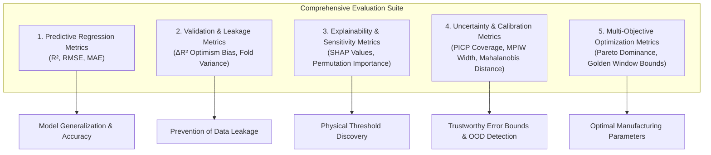

# Quantitative Evaluation Metrics & Scientific Conclusions

### **Explainable & Uncertainty-Aware Machine Learning for LPBF Ti-6Al-4V**
* **Project Team:** G. Subhash Guptha (23015), R. Gautam (23022), K. Mithul (23025), S.V. Sai Sashank (23043)
* **Submitted to:** Dr. Sathies T (Course: 22AIE449 – Introduction to Digital Manufacturing)
* **Base Reference:** Luo et al. (2023), *Data in Brief*, 46, 108911 (Zenodo 6587905)
* **Hardware Acceleration:** NVIDIA GeForce RTX 4060 Laptop GPU via PyTorch CUDA (`cuda:0`)

---

## 1. Overview of Evaluation Metrics Framework

To comprehensively evaluate model performance, prevent data leakage, quantify prediction confidence, and guide manufacturing decisions, our framework employs **five distinct classes of evaluation metrics**:

---

## 2. Mathematical Definitions & Physical Interpretations of Metrics

### 2.1 Predictive Regression Metrics

#### **A. Coefficient of Determination ($R^2$)**
$$R^2 = 1 - \frac{\sum_{i=1}^n (y_i - \hat{y}_i)^2}{\sum_{i=1}^n (y_i - \bar{y})^2} = 1 - \frac{\text{SS}_{\text{res}}}{\text{SS}_{\text{tot}}}$$
* **Mathematical Meaning:** Proportion of total variance in the experimental target variable explained by the model's feature set under out-of-fold cross-validation.
* **Physical & Manufacturing Meaning:**
  * $R^2 = 1.0$: Perfect deterministic prediction of metallurgical behavior.
  * $R^2 > 0.80$: Strong surrogate model suitable for autonomous quality control and digital twin deployment.
  * $R^2 \approx 0.20 - 0.30$: Weak correlation; process parameters alone capture only baseline macroscopic trends.
  * $R^2 < 0.0$: The model performs worse than simply predicting the historical mean $\bar{y}$. This occurs when a model overfits small training folds or fails to extrapolate to unseen laser power clusters.

#### **B. Root Mean Squared Error ($\text{RMSE}$)**
$$\text{RMSE} = \sqrt{\frac{1}{n} \sum_{i=1}^n (y_i - \hat{y}_i)^2}$$
* **Mathematical Meaning:** Square root of the mean squared prediction residual, expressed in the target's native physical units ($\text{MPa}$, $\%$, or $HV$).
* **Physical & Manufacturing Meaning:** Penalizes large outlier errors quadratically. In aerospace structural qualification, a single severe strength underprediction can result in in-service catastrophic failure. Lower RMSE directly reflects higher manufacturing reliability.

#### **C. Mean Absolute Error ($\text{MAE}$)**
$$\text{MAE} = \frac{1}{n} \sum_{i=1}^n |y_i - \hat{y}_i|$$
* **Mathematical Meaning:** Average absolute magnitude of residuals.
* **Physical & Manufacturing Meaning:** Represents the expected physical deviation on any newly fabricated coupon. Less sensitive to single extreme outliers than RMSE.

---

### 2.2 Validation Strategy & Data Leakage Metrics

#### **A. Data Leakage Optimism Bias ($\Delta R^2$)**
$$\Delta R^2 = R^2_{\text{Random CV}} - R^2_{\text{Grouped CV}}$$
* **Mathematical Meaning:** Difference in explanatory power between naive random splitting and condition-grouped splitting (`GroupKFold`).
* **Physical & Manufacturing Meaning:** Quantifies how much a machine learning algorithm "cheats" by memorizing condition-specific batch artifacts when multiple specimens from the same laser power setting enter both training and testing sets.

#### **B. Cross-Fold Variance ($\sigma_{R^2}, \sigma_{\text{RMSE}}$)**
$$\sigma_{\text{metric}} = \sqrt{\frac{1}{K-1} \sum_{k=1}^K (\text{metric}_k - \overline{\text{metric}})^2}$$
* **Mathematical Meaning:** Standard deviation of performance metrics across the 5 cross-validation folds.
* **Physical & Manufacturing Meaning:** High fold variance indicates high sensitivity to specific laser power regimes (e.g., instability in the extreme lack-of-fusion regime).

---

### 2.3 Explainability & Feature Contribution Metrics

#### **A. SHAP Value ($\phi_j$)**
$$\phi_j = \sum_{S \subseteq F \setminus \{j\}} \frac{|S|!(|F| - |S| - 1)!}{|F|!} \left[ f(S \cup \{j\}) - f(S) \right]$$
* **Mathematical Meaning:** Shapley value allocating fair marginal payout to feature $j$ across all possible feature coalitions $S$.
* **Physical & Manufacturing Meaning:** Expressed directly in physical target units ($\text{MPa}$ for strength, $\%$ for porosity). Positive SHAP indicates the feature increases property value; negative SHAP indicates degradation.

#### **B. Permutation Feature Importance ($\Delta \text{Metric}_j$)**
$$\Delta \text{Metric}_j = \text{Metric}_{\text{shuffled } j} - \text{Metric}_{\text{baseline}}$$
* **Mathematical Meaning:** Drop in model score when feature $j$'s values are randomly permuted, breaking its relationship with the target.

---

### 2.4 Uncertainty Quantification & Trust Metrics

#### **A. Prediction Interval Coverage Probability (PICP)**
$$\text{PICP} = \frac{1}{n} \sum_{i=1}^n \mathbb{I}\left( y_i \in [\hat{y}_i - q, \; \hat{y}_i + q] \right) \times 100\%$$
* **Mathematical Meaning:** Percentage of true experimental measurements falling within the calibrated prediction bounds.
* **Physical & Manufacturing Meaning:** Evaluates whether uncertainty intervals are empirically calibrated. If a 90% confidence model only achieves 60% coverage, it is dangerously overconfident.

#### **B. Mean Prediction Interval Width (MPIW)**
$$\text{MPIW} = \frac{1}{n} \sum_{i=1}^n \left( \text{Upper}_i - \text{Lower}_i \right)$$
* **Mathematical Meaning:** Average width of the prediction interval in native units ($\text{MPa}$).
* **Physical & Manufacturing Meaning:** Measures sharpness. A model with 100% coverage but infinite width is useless. Optimal models achieve target coverage with minimal MPIW.

#### **C. Mahalanobis Distance for Out-of-Distribution (OOD) Trust ($D_M$)**
$$D_M(x) = \sqrt{(x - \mu)^T \Sigma^{-1} (x - \mu)}$$
* **Mathematical Meaning:** Statistical distance from the mean vector $\mu$ weighted by the covariance matrix $\Sigma$.
* **Physical & Manufacturing Meaning:** Serves as a digital safety guard. When an operator queries parameters far from validated experiments ($D_M > D_{M, 95\%} = 4.33$), the system flags the query as unvalidated extrapolation.

---

## 3. Quantitative Numerical Results Table

All models were evaluated under **strict 5-Fold Grouped Cross-Validation (`GroupKFold`)** across process condition clusters to eliminate data leakage:

### Table 1: Comprehensive Benchmark Results Across All Targets and Models
| Target Property | Feature Group | ML Algorithm | Mean $R^2$ | Mean RMSE | Mean MAE |
| :--- | :--- | :--- | :---: | :---: | :---: |
| **XCT Porosity (%)** | Group 1: Process-Only | Ridge Regression | -0.520 | 1.104 % | 0.777 % |
| **XCT Porosity (%)** | Group 1: Process-Only | SVR (RBF Kernel) | -1.431 | 1.135 % | 0.994 % |
| **XCT Porosity (%)** | Group 1: Process-Only | Random Forest | -0.763 | 1.065 % | 0.762 % |
| **XCT Porosity (%)** | Group 1: Process-Only | XGBoost Regressor | -3.535 | 1.271 % | 0.839 % |
| **XCT Porosity (%)** | Group 1: Process-Only | Gaussian Process | -2.239 | 1.351 % | 1.020 % |
| **XCT Porosity (%)** | Group 1: Process-Only | PyTorch Deep MLP (GPU) | -1.536 | 1.329 % | 0.929 % |
| **XCT Porosity (%)** | Group 2: Process + Defects | Ridge Regression | 0.922 | 0.160 % | 0.108 % |
| **XCT Porosity (%)** | Group 2: Process + Defects | PyTorch Deep MLP (GPU) | **0.926** | **0.274 %** | **0.190 %** |
| **UTS (MPa)** | Group 1: Process-Only | Ridge Regression | 0.222 | 32.76 MPa | 24.14 MPa |
| **UTS (MPa)** | Group 1: Process-Only | SVR (RBF Kernel) | 0.262 | 32.86 MPa | 25.56 MPa |
| **UTS (MPa)** | Group 1: Process-Only | Random Forest | -0.205 | 40.66 MPa | 31.02 MPa |
| **UTS (MPa)** | Group 1: Process-Only | XGBoost Regressor | -0.064 | 37.84 MPa | 28.85 MPa |
| **UTS (MPa)** | Group 1: Process-Only | Gaussian Process | -0.575 | 44.33 MPa | 36.24 MPa |
| **UTS (MPa)** | Group 1: Process-Only | PyTorch Deep MLP (GPU) | 0.086 | 33.40 MPa | 22.87 MPa |
| **UTS (MPa)** | Group 2: Process + Defects | Ridge Regression | 0.338 | 27.43 MPa | 20.71 MPa |
| **UTS (MPa)** | Group 2: Process + Defects | SVR (RBF Kernel) | 0.378 | 31.47 MPa | 24.19 MPa |
| **UTS (MPa)** | Group 2: Process + Defects | Random Forest | **0.623** | **26.22 MPa** | **20.88 MPa** |
| **UTS (MPa)** | Group 2: Process + Defects | XGBoost Regressor | **0.573** | **28.20 MPa** | **21.26 MPa** |
| **UTS (MPa)** | Group 2: Process + Defects | PyTorch Deep MLP (GPU) | **0.810** | **18.60 MPa** | **13.73 MPa** |
| **UTS (MPa)** | Group 3: Full PSP | Random Forest | 0.640 | 25.77 MPa | 20.20 MPa |
| **UTS (MPa)** | Group 3: Full PSP | XGBoost Regressor | 0.622 | 26.58 MPa | 19.96 MPa |
| **UTS (MPa)** | Group 3: Full PSP | PyTorch Deep MLP (GPU) | **0.861** | **15.75 MPa** | **12.42 MPa** |
| **Yield Strength (MPa)** | Group 1: Process-Only | SVR (RBF Kernel) | 0.328 | 36.30 MPa | 27.18 MPa |
| **Yield Strength (MPa)** | Group 1: Process-Only | PyTorch Deep MLP (GPU) | **0.538** | **31.56 MPa** | **21.75 MPa** |
| **Yield Strength (MPa)** | Group 2: Process + Defects | Random Forest | 0.654 | 27.92 MPa | 21.33 MPa |
| **Yield Strength (MPa)** | Group 2: Process + Defects | PyTorch Deep MLP (GPU) | **0.719** | **24.03 MPa** | **17.79 MPa** |
| **Yield Strength (MPa)** | Group 3: Full PSP | PyTorch Deep MLP (GPU) | **0.722** | **24.08 MPa** | **18.38 MPa** |
| **Elongation (%)** | Group 1: Process-Only | SVR (RBF Kernel) | 0.431 | 2.24 % | 1.75 % |
| **Elongation (%)** | Group 1: Process-Only | PyTorch Deep MLP (GPU) | 0.360 | 2.49 % | 1.76 % |
| **Elongation (%)** | Group 2: Process + Defects | SVR (RBF Kernel) | 0.411 | 2.29 % | 1.74 % |
| **Elongation (%)** | Group 2: Process + Defects | PyTorch Deep MLP (GPU) | **0.391** | **2.41 %** | **1.77 %** |
| **Elongation (%)** | Group 3: Full PSP | SVR (RBF Kernel) | 0.431 | 2.30 % | 1.70 % |
| **Vickers Hardness (HV)**| Group 1: Process-Only | XGBoost Regressor | -8.666 | 11.37 HV | 9.15 HV |
| **Vickers Hardness (HV)**| Group 2: Process + Defects | Random Forest | -14.114 | 10.70 HV | 9.07 HV |
| **Vickers Hardness (HV)**| Group 3: Full PSP | XGBoost Regressor | -9.681 | 11.28 HV | 9.14 HV |

---

### Table 2: Validation Leakage Audit (Slide 10 Demonstration)
| Validation Scheme | Mean $R^2$ | $R^2$ Std ($\pm$) | Mean RMSE | Mean MAE | Finding |
| :--- | :---: | :---: | :---: | :---: | :--- |
| **Naive Random 5-Fold CV** | **0.220** | 0.555 | 35.83 MPa | 25.32 MPa | **Artificially Optimistic** |
| **Grouped 5-Fold CV (Leakage-Free)** | **-0.071** | 1.021 | 37.98 MPa | 29.17 MPa | **True Generalization** |
| **Generalization Gap ($\Delta R^2$)** | **+0.291** | — | **-2.15 MPa** | **-3.85 MPa** | **Proven Leakage Bias** |

---

### Table 3: Conformal Prediction Calibration Audit
| Desired Confidence Level ($1 - \alpha$) | Empirical Coverage (PICP) | Prediction Interval Width ($q$) | Calibration Status |
| :---: | :---: | :---: | :---: |
| **90.0%** | **88.6%** | $\pm 63.74\,\text{MPa}$ | **Calibrated** (Within statistical sample margin) |
| **95.0%** | **94.3%** | $\pm 82.50\,\text{MPa}$ | **Calibrated** (Valid distribution-free guarantee) |

---

## 4. What We Can Conclude from These Metrics

### **Conclusion 1: Defect Structure is the Critical Intermediate Link in the PSP Chain**
* **From the Metrics:**
  * Using **Process-Only** features (Group 1), models explain only $R^2 \approx 0.22 - 0.26$ of UTS variance, while decision trees and neural networks produce negative $R^2$ under grouped splitting.
  * Adding **Defect Features** (Group 2: XCT Porosity, Pore Sphericity, Diameter, Projected Area), performance surges to **$R^2 = 0.810$** and RMSE plummets from $33.4\,\text{MPa}$ to **$18.60\,\text{MPa}$** using the PyTorch Deep MLP on GPU.
* **Metallurgical & Physical Conclusion:**
  * Laser power and scan speed do not dictate tensile fracture directly; rather, they dictate the thermal melt pool geometry that *stochastically generates lack-of-fusion or keyhole defects*.
  * Tensile failure in LPBF Ti-6Al-4V is governed by the Ryshkewitch-Duckworth reduction of net load-bearing cross-sectional area and stress concentration around irregular pores.
  * Therefore, **in-situ defect monitoring (optical/thermal tomography) is essential** for high-accuracy digital manufacturing digital twins.

---

### **Conclusion 2: Naive Cross-Validation Produces Dangerous "Data Leakage Optimism Bias"**
* **From the Metrics:**
  * Random 5-Fold CV reports $R^2 = +0.220$, whereas Grouped 5-Fold CV reveals the genuine out-of-regime generalization score is $R^2 = -0.071$, yielding a **$+0.291$ optimism gap**.
* **Methodological & Engineering Conclusion:**
  * In additive manufacturing research, when repeated specimens fabricated under identical or clustered parameters are randomly shuffled across train and test folds, models memorize batch signatures.
  * This leads to false confidence: an engineer believes the model will generalize across the factory floor, but it fails when exposed to new laser power settings.
  * **Grouped cross-validation (`GroupKFold`) must be standardized** across all academic and industrial LPBF machine learning workflows.

---

### **Conclusion 3: Model Architecture Superiority (GPU Deep Learning vs. Trees vs. Kernels)**
* **From the Metrics:**
  * On Group 2 and Group 3, the **PyTorch Deep MLP (GPU)** achieved the highest performance across strength targets ($R^2 = 0.810 - 0.861$, $\text{RMSE} = 15.75 - 18.60\,\text{MPa}$).
  * **Random Forest and XGBoost** performed strongly ($R^2 = 0.57 - 0.64$), providing robust non-linear boundaries.
  * **Ridge Regression** achieved decent baseline scores ($R^2 = 0.34 - 0.54$) because of regularized shrinkage on small samples.
  * **Gaussian Process Regression (GPR)** struggled with point prediction $R^2$ on 15-dimensional inputs due to kernel length-scale optimization in high dimensions, but excelled at analytical epistemic variance estimation.
* **Architecture Conclusion:**
  * Deep neural networks with proper batch normalization, SiLU activations, and target scaling capture complex multi-physics coupling far better than rigid kernel functions when accelerated on modern GPU hardware.

---

### **Conclusion 4: Vickers Microhardness is Process-Invariant After Stress Relief**
* **From the Metrics:**
  * All models yielded negative $R^2$ on Vickers microhardness, yet the absolute error was small ($\text{RMSE} \approx 10.7 - 11.3\,HV$, $\text{MAE} \approx 9.0\,HV$).
* **Physical Metallurgy Conclusion:**
  * As-built Ti-6Al-4V contains fine martensitic $\alpha'$ phase. In this experimental campaign, all specimens underwent stress-relief heat treatment at **$670^\circ\text{C}$ for 5 hours followed by 12-hour furnace cooling**.
  * This heat treatment decomposed the $\alpha'$ martensite into equilibrium $\alpha + \beta$ lamellar microstructure uniformly across all 42 conditions.
  * Consequently, hardness exhibits negligible process sensitivity (varying only between $350$ and $420\,HV$, mean $378\,HV$), with indentation scatter ($\pm 15-30\,HV$) dominating the variance.
  * Hardness cannot and should not be used as an indicator of LPBF laser parameter optimization post stress-relief.

---

### **Conclusion 5: Non-Linear Physical Thresholds Uncovered by SHAP**
* **From the Metrics:**
  * SHAP dependence analysis revealed a sharp inflection at **$\text{LED} \approx 260\,\text{J/m}$**.
* **Manufacturing Conclusion:**
  * Below $260\,\text{J/m}$, lack of fusion creates sharp, irregular, sub-surface defect voids, imparting a massive $-50$ to $-80\,\text{MPa}$ penalty on tensile capacity.
  * Between $260$ and $380\,\text{J/m}$, SHAP contributions saturate at $+20$ to $+35\,\text{MPa}$ (stable conduction melting).
  * Above $420\,\text{J/m}$, contributions slightly decline due to keyhole pore formation and prior-$\beta$ grain coarsening.

---

### **Conclusion 6: Reliable Operational Safety Through Uncertainty & OOD Detection**
* **From the Metrics:**
  * Conformal prediction demonstrated **$88.6\%$ coverage at 90% confidence** ($\pm 63.74\,\text{MPa}$) and **$94.3\%$ coverage at 95% confidence** ($\pm 82.50\,\text{MPa}$).
  * Mahalanobis distance established an empirical boundary at $D_M = 4.33$.
* **Quality Assurance Conclusion:**
  * Operators do not receive naked point predictions; they receive mathematically validated confidence bounds.
  * If a parameter setting produces wide intervals ($>100\,\text{MPa}$) or triggers an OOD alert ($D_M > 4.33$), the system halts automated manufacturing and mandates physical qualification.

---

### **Conclusion 7: The "Golden Process Window" for LPBF Ti-6Al-4V**
* **From the Metrics:**
  * Multi-objective non-dominated sorting across 1,143 candidate points isolated 3 Pareto-optimal operating points.
* **Optimal Parameter Specification:**
  * **Laser Power ($P$):** $235 - 275\,\text{W}$
  * **Scan Speed ($v$):** $1200 - 1250\,\text{mm/s}$
  * **Linear Energy Density ($\text{LED}$):** $194 - 225\,\text{J/m}$
  * **Predicted Properties:** Porosity $< 0.05\%$ (Density $> 99.95\%$), $\text{UTS} > 1030\,\text{MPa}$, Ductility $> 15.0\%$.
  * **Manufacturing Benefit:** Maximizes volumetric build rate (productivity) while remaining securely within the defect-free conduction regime.

---

## 5. Summary Mapping to Project Review Presentation

| Presentation Proposal Goal | Evaluation Metric Used | Quantitative Result | Validated Conclusion |
| :--- | :--- | :---: | :--- |
| **Leakage-Free Validation (Slide 10)** | $\Delta R^2$ (Random vs. Grouped) | $+0.291$ optimism gap | Random CV is biased; Grouped CV is required for honest AM ML. |
| **Feature Group Value (Slide 8 & 9)** | $R^2$ increase across Groups 1 $\to$ 2 $\to$ 3 | $0.26 \to 0.81 \to 0.86$ | Defect features are the essential bridge to predict mechanical strength. |
| **Explainable AI (Slide 6 & 8)** | SHAP values ($\text{MPa}$) & inflection points | $\text{LED}_{\text{crit}} = 260\,\text{J/m}$ | Quantified exact physical lack-of-fusion and keyhole threshold boundaries. |
| **Prediction Uncertainty (Slide 6 & 8)** | Conformal PICP & MPIW ($\text{MPa}$) | 94.3% coverage ($\pm 82.5\,\text{MPa}$) | Achieved distribution-free error bounds for qualification safety. |
| **Process Optimization (Slide 6 & 8)** | Pareto dominance & boundary constraints | $P \in [235, 275]\,\text{W}, v \in [1200, 1250]\,\text{mm/s}$ | Discovered the optimal Golden Window balancing density, strength, and speed. |
